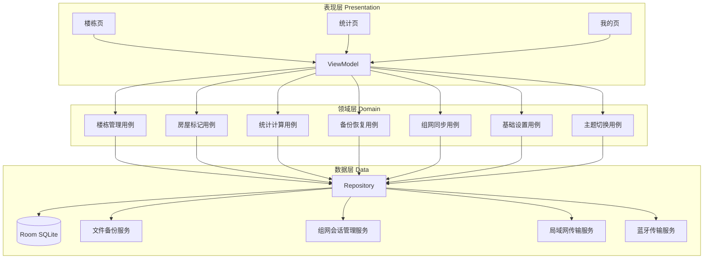
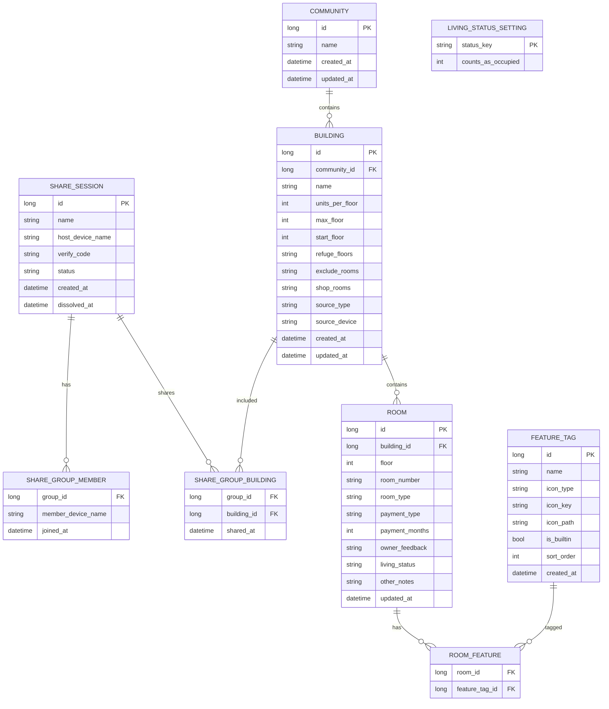
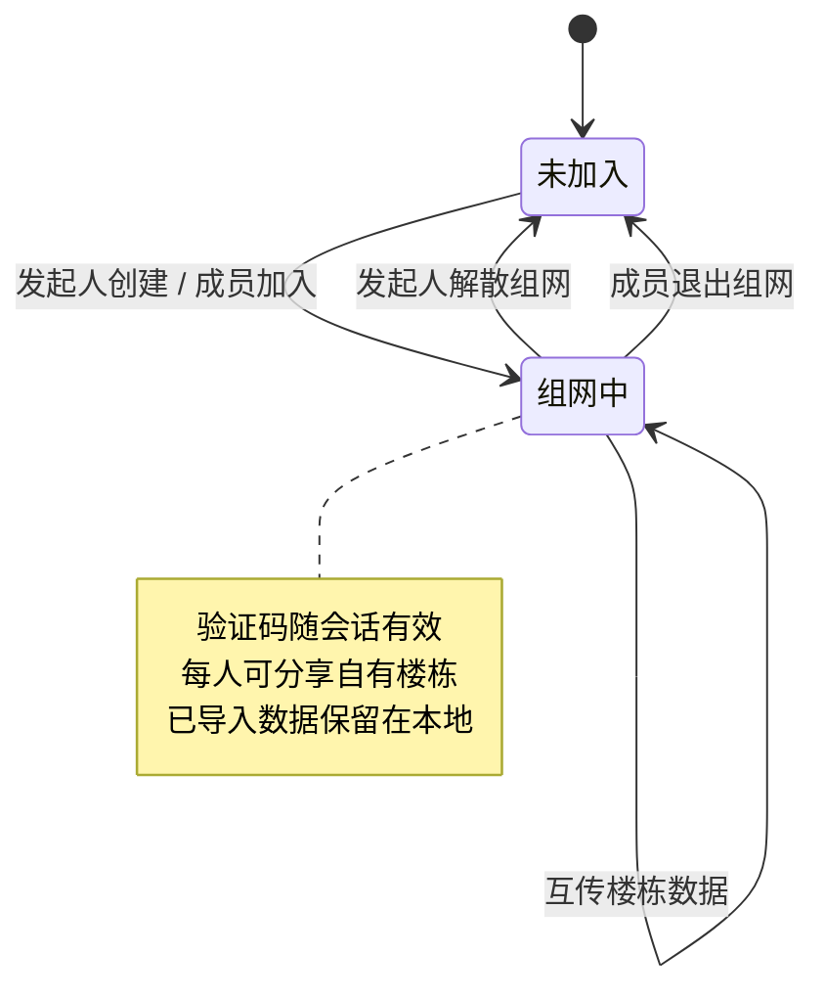
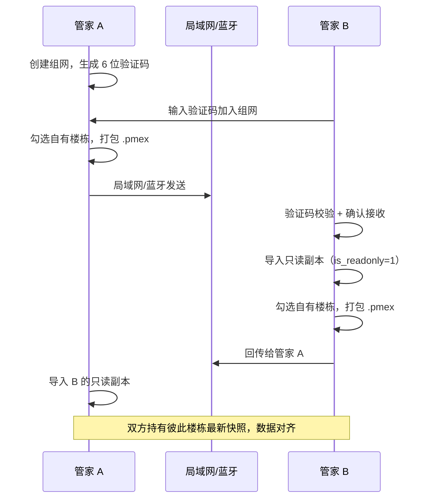
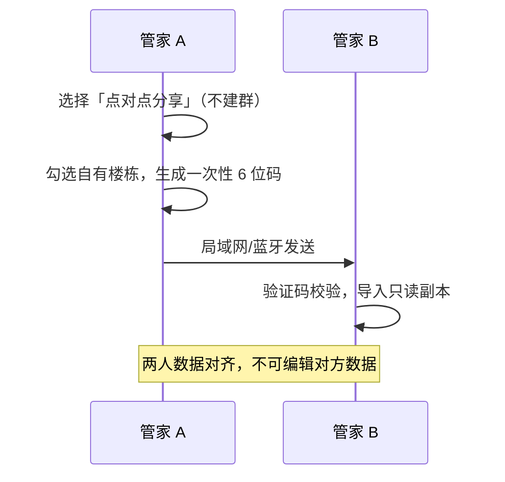
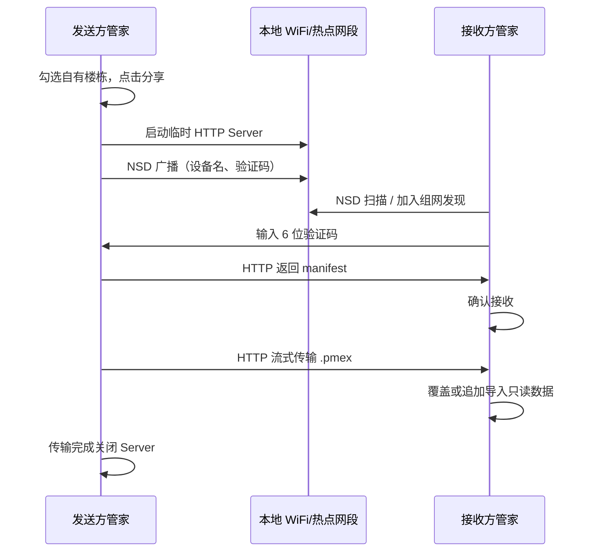
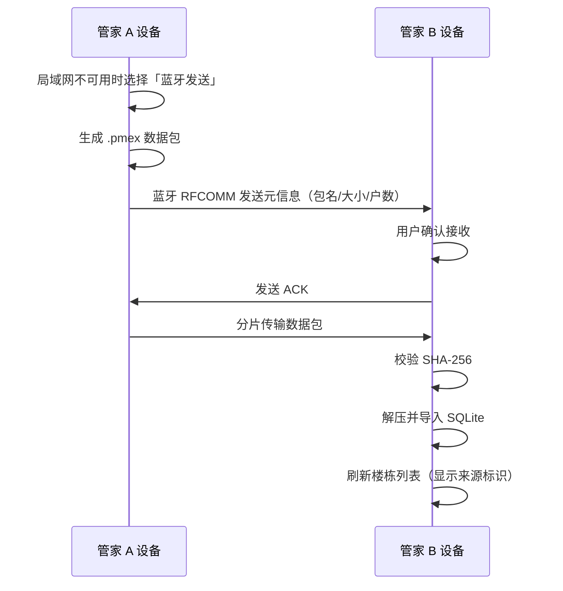

# 物业管家助手 — 开发设计文档


| 属性   | 内容                  |
| ---- | ------------------- |
| 文档版本 | v1.10.0             |
| 创建时间 | 2026-06-05 11:51:20 |
| 最后更新 | 2026-11-12          |
| 文档状态 | 已全部确认（实施中，进度见 §10.3） |
| 适用平台 | Android（本机离线）       |


---

## 1. 项目概述

### 1.1 项目背景

物业管家在日常工作中需要独立记录各楼栋房屋的物业费收缴情况、业主沟通记录、居住状态及住户特征信息。现有通用工具难以满足「按楼栋可视化」「快速标记」「离线统计」等场景需求。

本项目旨在开发一款 **Android 原生应用**，数据全部存储于本机 SQLite。管家可手动加密备份数据；通过**临时组网会话**（局域网/蓝牙）按楼栋互传数据以实现多管家间数据对齐——每人仅维护自有数据，他人数据只读查看，无需依赖云端或公网服务。

### 1.2 项目目标


| 目标     | 说明                              |
| ------ | ------------------------------- |
| 楼栋房屋管理 | 批量创建楼栋与房间，可视化楼层网格展示             |
| 房屋信息标记 | 物业费、业主原声、居住状态、可扩展特征标记           |
| 数据统计分析 | 汇总指标、居住分布、缴费饼图、特征画像柱状图          |
| 本机数据安全 | SQLite 本地存储，手动加密备份与恢复           |
| 临时组网会话 | 管家发起临时组网（WiFi/蓝牙），成员加入后互相分享楼栋数据 |
| 数据对齐   | 通过互传使各管家持有他人楼栋的最新只读副本，统计可切换查看整体 |
| 基础设置   | 可配置各居住状态是否计入入住率统计               |
| 主题色选择  | 我的页面切换 4 套预设 Web 风格配色，全局即时生效    |
| 点对点分享  | 不建群时，两人直接互传楼栋数据（只读导入）           |
| 局域网传输  | 组网数据传输主通道                       |
| 蓝牙传输   | 组网数据传输备用通道                      |


### 1.3 术语定义


| 术语     | 定义                                        |
| ------ | ----------------------------------------- |
| 小区     | 物业管理区域，可包含多个楼栋                            |
| 楼栋     | 小区内独立建筑，含楼层与户数规则                          |
| 房屋/房间  | 楼栋内最小管理单元，如 601（住宅）或 S01（商铺）              |
| 住宅房间   | 按「楼层 + 户序号」规则自动生成的房间                      |
| 商铺房间   | 不遵循楼层户数规则、由用户手动录入编号的商业用房                  |
| 避难层    | 不生成住宅房间的特殊楼层                              |
| 缴费月数   | 物业费以「月」为计量单位，预存/欠费均记录月数                   |
| 特征标记   | 描述住户特征的图标+文字标签，如老人、宠物                     |
| 收缴率    | 非欠费户数占总户数的比例                              |
| 入住率    | 居住状态被标记为「计入入住」的户数占总户数的比例（可在基础设置中配置）       |
| 出租率    | 已出租户数占总户数的比例                              |
| 组网发起人  | 创建临时组网会话、生成 6 位验证码的管家（会话主，非独占分享者）         |
| 临时组网会话 | 为共享数据而临时搭建的蓝牙/WiFi 组网，解散后会话结束，本地已导入数据保留   |
| 群组验证码  | 6 位数字，随组网会话生效，会话解散即失效；用于加入组网及传输校验（不含密码）   |
| 数据对齐   | 组网内各管家互传自有楼栋，使彼此持有最新只读副本                  |
| 点对点分享  | 不创建组网会话，两名管家直接互传所选楼栋数据                    |
| 局域网传输  | 组网内设备接入同一本地网络（WiFi / 热点），通过应用内 HTTP 传输数据包 |
| 我的统计   | 仅统计本管家自己创建/维护的楼栋数据（`source_type=local`）   |
| 整体统计   | 统计本管家数据 + 所有已导入的同事楼栋数据                    |
| 主题色    | 用户可在我的页面选择的预设配色方案，影响全局 UI 色调              |


### 1.4 不在本期范围

- 云端同步、账号登录、多设备实时同步
- 在线支付、账单推送、短信通知
- iOS / Web / 小程序端
- 「沟通」Tab 的任何功能（本期为空白页，后续版本扩展）

---

## 2. 需求分析

### 2.1 功能需求总览

```
物业管家助手
├── 楼栋（Tab 1）
│   ├── 空态引导：新建楼栋 / 加入临时组网
│   ├── 楼栋列表切换 + 新增楼栋（含导入楼栋，可删除）
│   ├── 管理区域表单（批量生成房间）
│   ├── 楼层网格展示（收缴状态 + 特征图标）
│   └── 房屋详情编辑弹窗（导入数据仅查看）
├── 统计（Tab 2）
│   ├── 统计范围切换：我的统计（默认）/ 整体统计
│   ├── 汇总指标卡片（总户数/出租率/欠费户/入住率/收缴率，可点击查看清单）
│   ├── 居住状态分布
│   ├── 缴费情况分析（饼图）
│   └── 特征画像（柱状图 + 图标）
├── 沟通（Tab 3）— 空白页
└── 我的（Tab 4）
    ├── 主题色选择（4 套预设配色方案）
    ├── 数据备份与恢复（手动导出，密码加密）
    ├── 基础设置（入住统计标记配置）
    └── 临时组网（创建/加入/互传楼栋）+ 点对点分享入口
```

### 2.2 模块一：楼栋与房屋管理

#### 2.2.1 创建楼栋和房屋信息

**入口：** 楼栋页空态「新建楼栋」按钮，或已有楼栋时「+ 新增」。

**管理区域表单字段：**


| 字段   | 必填  | 类型  | 说明                           |
| ---- | --- | --- | ---------------------------- |
| 小区名称 | 是   | 文本  | 如「A 小区」                      |
| 楼栋   | 是   | 文本  | 如「1」「A 栋」                    |
| 每层户数 | 是   | 正整数 | 如 4                          |
| 最高楼层 | 是   | 正整数 | 如 18                         |
| 起始楼层 | 是   | 正整数 | 如 1                          |
| 避难层  | 否   | 文本  | 逗号分隔，如 `4,14,24`，不生成房间       |
| 剔除房间 | 否   | 文本  | 逗号分隔，如 `102,303,1501,18-03`  |
| 商铺房间 | 否   | 文本  | 逗号分隔，如 `S01,S02,1-01`，手动录入编号 |


**房间号格式（两种）：**


| 类型  | 编号规则        | 生成方式          | 示例                  |
| --- | ----------- | ------------- | ------------------- |
| 住宅  | 楼层号 + 两位户序号 | 按楼层参数自动生成     | `101`、`604`、`1803`  |
| 商铺  | 用户自定义编号     | 在「商铺房间」字段手动录入 | `S01`、`1-01`、`铺-01` |


**住宅房间生成规则：**

1. 遍历 `起始楼层` 至 `最高楼层`。
2. 跳过避难层列表中的楼层。
3. 每层按 `每层户数` 生成住宅房间，编号格式：`楼层号 + 两位户序号`。
  - 例：第 1 层 4 户 → `101, 102, 103, 104`
  - 例：第 6 层 4 户 → `601, 602, 603, 604`
4. 剔除「剔除房间」列表中匹配的房间号（支持 `18-03` 表示 `1803` 的扩展格式）。
5. 住宅房间标记 `room_type=residential`。

**商铺房间生成规则：**

1. 解析「商铺房间」字段，按逗号分隔为独立编号。
2. 每个编号直接写入 `rooms` 表，标记 `room_type=shop`。
3. 商铺房间 `floor` 字段置为 `0`（或 `-1`），在网格底部以独立「商铺」区域展示，不参与楼层纵向排列。
4. 商铺编号全局唯一性约束在同一楼栋内（`building_id + room_number` 唯一）。

**保存：** 住宅与商铺房间一并批量插入，初始物业费状态均为「欠费 1 个月」。

**楼栋操作：**

- 长按楼栋 Tab 按钮：
  - **本地楼栋**：修改楼栋参数 / 删除楼栋（二次确认，级联删除下属房间）。
  - **导入楼栋**（同事数据）：仅支持**删除**（移除本机只读副本），**不可编辑**参数或房间数据。
- 底部提示文案：「长按楼栋按钮，可修改该楼栋参数或删除楼栋」。

#### 2.2.2 楼栋展示页

**顶部：**

- 当前小区/楼栋名称
- 楼栋切换 Tab（如 `1`）+ `+ 新增`

**汇总卡片（当前楼栋）：**


| 指标  | 计算方式                                    |
| --- | --------------------------------------- |
| 入住率 | `计入入住的居住状态户数 / 总户数 × 100%`（状态是否计入见基础设置） |
| 收缴率 | `(预存 + 正常) / 总户数 × 100%`                |
| 出租率 | `已租 / 总户数 × 100%`                       |


**楼层网格：**

- 左侧纵向楼层号（从高到低或从低到高，默认从 1 向上排列，与参考 UI 一致）。
- 每格显示：
  - 左上角：物业费状态简写（预存 / 欠费 N 月 / 正常）
  - 中央：房间号
  - 右上角或底部：特征标记图标（最多显示 3 个，超出显示 `+N`）
- 点击房间格：
  - **本地楼栋**：打开房屋详情编辑弹窗。
  - **导入楼栋**：打开只读详情页（可查看，不可保存，见 §5.1）。
- 网格底部独立展示「商铺」区域（有商铺房间时显示）。
- 颜色规范见 [§6.3 视觉规范](#63-视觉规范)。

#### 2.2.3 房屋信息标记

**弹窗标题：** 房间号（如 `601`）。

**物业费收缴（物业缴费）：**

> 物业费统一按**月份**计量，所有预存、欠费、统计均基于月数计算，不使用天或年为单位。


| 状态  | 交互              | 存储                                         | 说明            |
| --- | --------------- | ------------------------------------------ | ------------- |
| 预存  | 选择后输入预存月数       | `payment_type=prepaid`, `payment_months=N` | 已提前缴纳 N 个月物业费 |
| 欠费  | 选择后输入欠费月数（默认 1） | `payment_type=arrears`, `payment_months=N` | 已连续欠费 N 个月    |
| 正常  | 选择即生效           | `payment_type=normal`, `payment_months=0`  | 当月已缴，无欠费无预存   |


**展示文案：** 网格与详情中统一显示为「预存 N 月」「欠费 N 月」「正常（当月已缴）」。

**业主原声：**

- 多行文本，记录业主问题与沟通内容，对应字段 `owner_feedback`。

**居住状态（单选）：**


| 大类  | 子状态 | 枚举值                  |
| --- | --- | -------------------- |
| 自住  | 长住  | `self_long_term`     |
| 自住  | 度假  | `self_vacation`      |
| 出租  | 已租  | `rent_rented`        |
| 出租  | 待租  | `rent_available`     |
| 空置  | 已收楼 | `vacant_delivered`   |
| 空置  | 未收楼 | `vacant_undelivered` |


**特征标记：**

- 内置标签：老人、小孩、宠物、在售、车辆（内置图标）。
- 支持用户自定义：文字名称 + 图标，图标来源三选一：
  1. 预设图标库
  2. Emoji 映射
  3. **自定义图片上传**（从相册选择或拍照）
- **自定义图片约束：**
  - 原始文件限制 ≤ 2 MB
  - 上传后进入**裁剪界面**，默认 1:1 正方形，**可选自由裁剪**截取部分区域
  - 裁剪输出限制 ≤ 200 KB，存储分辨率 128×128 px
  - 保存至本机 `feature_icons/` 目录，随楼栋数据一并分享
- 多选，选中后同步至房屋网格展示。
- 特征数据用于统计页「特征画像」模块。

**其他：**

- 单行备注字段 `other_notes`。

**保存：** 写入 SQLite，刷新当前楼栋网格与顶部汇总指标。导入的只读楼栋/房间不显示保存入口。

### 2.3 模块二：统计页面

#### 2.3.1 统计范围切换

页面顶部提供切换按钮，默认显示**我的统计**：


| 模式   | 默认  | 统计范围                    | 说明            |
| ---- | --- | ----------------------- | ------------- |
| 我的统计 | 是   | `source_type=local` 的楼栋 | 仅本管家自己创建维护的数据 |
| 整体统计 | 否   | 本地楼栋 + 所有导入楼栋           | 含群组内其他管家分享的数据 |


切换后，下方所有指标卡片、分布图、饼图、特征画像同步刷新。

#### 2.3.2 汇总指标卡片

展示当前统计范围 + 楼栋筛选（全部 / 指定楼栋）下的五项指标：


| 指标  | 可点击 | 点击后清单内容                                 |
| --- | --- | --------------------------------------- |
| 总户数 | 是   | 当前范围内全部房间列表                             |
| 出租率 | 是   | `居住状态=已租` 的房间                           |
| 欠费户 | 是   | `payment_type=arrears` 的房间              |
| 入住率 | 是   | 基础设置中标记为「计入入住」的居住状态房间                   |
| 收缴率 | 是   | `payment_type IN (prepaid, normal)` 的房间 |


清单页支持按楼栋、楼层、房间号排序，点击条目跳转房屋详情。导入数据（`is_readonly=1`）以只读模式展示。

#### 2.3.3 居住状态分布（§2.1）

- 顶部 Tab：`全部` / 各楼栋编号。
- 横向进度条展示各居住子状态户数与占比。
- 状态分组顺序：未收楼、已收楼、长住、度假、已租、待租。
- 点击某一状态条可展开对应房间清单。

#### 2.3.4 缴费情况分析（§2.2）

- 使用 **ComposeCharts** 环形饼图展示：预存 / 欠费 / 正常 三类占比。
- 图例显示户数。
- 中心显示总户数。
- 饼图下方列表按**欠费月数区间**展示欠费明细（固定区间，按月统计）：


| 区间标签      | 月数范围    | 统计条件                             |
| --------- | ------- | -------------------------------- |
| 欠费 1 个月   | 1 月     | `payment_months = 1`             |
| 欠费 2-3 个月 | 2 ~ 3 月 | `payment_months BETWEEN 2 AND 3` |
| 欠费 4-6 个月 | 4 ~ 6 月 | `payment_months BETWEEN 4 AND 6` |
| 欠费 7 个月以上 | ≥ 7 月   | `payment_months >= 7`            |


- 点击各区间行可展开对应房间清单，清单中显示具体欠费月数。

#### 2.3.5 特征画像（§2.3）

- 按特征标记聚合户数。
- 使用 **ComposeCharts** 横向柱状图展示。
- 每项显示：特征图标 + 名称 + 说明文字 + 户数。
- 无数据特征不展示或置灰。
- 点击柱条查看对应房间清单。

### 2.4 模块三：我的页面

**我的页入口列表（自上而下）：**


| 入口    | 图标建议  | 跳转       |
| ----- | ----- | -------- |
| 主题色   | 调色盘   | 主题色选择页   |
| 数据备份  | 云/文件夹 | 备份与恢复页   |
| 基础设置  | 齿轮    | 入住统计标记配置 |
| 临时组网  | 用户组   | 组网会话页    |
| 点对点分享 | 设备互联  | 点对点分享页   |


#### 2.4.1 主题色选择

提供 **4 套预设 Web 风格配色方案**，用户在「我的 → 主题色」中切换，**全局即时生效**（无需重启 App）。

**交互设计：**

- 页面以卡片网格展示 4 个主题，每卡片包含：
  - 主题名称 + 一句话描述
  - 主色 / 辅色 / 强调色 三色圆点预览
  - 迷你样例条（模拟按钮 + 房间格 + 欠费/预存标签）
- 当前选中主题显示勾选角标 + 高亮边框。
- 点击即切换，全 App 颜色立即刷新（Compose `MaterialTheme` 动态重组）。
- 选择结果持久化至本机，下次启动自动恢复。

**主题作用范围：**


| 随主题变化               | 不随主题变化          |
| ------------------- | --------------- |
| 主色、辅色、强调色、背景、卡片、文字色 | 欠费/预存/正常的语义含义   |
| 房间格默认底色、底部导航、按钮、进度条 | 缴费状态的业务逻辑       |
| 统计卡片、饼图容器色、特征柱图同类色阶 | 图表数据与结构         |
| 欠费/预存/正常语义色         | 四套主题保持一致，不随皮肤变化 |
| 组网验证码展示区、只读角标色      | —               |


**默认主题：** 方案 A「蔚蓝商务」（首次安装自动应用）。

#### 2.4.2 数据备份（手动导出）

> **手动备份强制密码加密**；与群组共享分离，群组共享仅使用 6 位验证码，不使用密码。


| 功能     | 说明                                                                            |
| ------ | ----------------------------------------------------------------------------- |
| 手动导出备份 | 用户点击「导出备份」，设置密码（≥6 位），系统将 SQLite 数据库、自定义特征图片等资源 AES-256 加密后打包为 `.pmbackup` 文件 |
| 系统分享发出 | 导出后支持通过系统分享（微信、文件管理器、邮件等）将 `.pmbackup` 发往其他存储位置                               |
| 导入备份   | 选择 `.pmbackup` 文件，输入正确密码解密校验后覆盖恢复本地数据                                         |
| 密码校验   | 密码错误时拒绝导入并提示，不尝试部分解密                                                          |
| 自动备份   | 可选（二期）：使用已设置的备份密码定期自动导出                                                       |
| 备份信息   | 显示最近备份时间、文件大小、户数统计                                                            |


#### 2.4.3 基础设置

提供「入住统计标记」配置页面，控制各居住状态是否计入入住率：


| 居住状态 | 默认「计入入住」 | 可配置 |
| ---- | -------- | --- |
| 长住   | 是        | 是   |
| 已租   | 是        | 是   |
| 度假   | 否        | 是   |
| 待租   | 否        | 是   |
| 已收楼  | 否        | 是   |
| 未收楼  | 否        | 是   |


- 每项提供开关 Toggle：「计入入住统计」。
- 配置存储于 `living_status_settings` 表，变更后实时刷新楼栋页与统计页入住率。
- 出租率、收缴率不受此配置影响。

#### 2.4.4 临时组网（共享群组）

> **核心定位：** 群组不是持久组织，而是为共享数据而**临时搭建的蓝牙/WiFi 组网会话**。解散群组仅结束组网，已导入本地的数据副本**继续保留**。

**会话约束：**

- 每台设备**同时只能加入一个组网会话**，以「群组名 + 组网发起人」区分。
- 6 位验证码**随会话存在**，组网解散即失效（非固定 24 小时）。
- 组网会话**无硬性时长上限**，由发起人手动解散；单次数据传输超时 **10 分钟**自动中断。

**角色与权限：**


| 角色     | 权限                               |
| ------ | -------------------------------- |
| 组网发起人  | 创建会话、生成验证码、解散组网（结束会话）            |
| 所有加入管家 | 均可选择自有楼栋发起分享；均可接收他人分享；均可查看他人只读数据 |


**创建与加入流程：**

1. 发起人进入「临时组网」→「创建组网」，填写群组名称，系统生成 **6 位验证码**。
2. 其他管家在局域网/蓝牙可达范围内 →「加入组网」→ 输入验证码。
3. 加入成功后记录会话关系（`share_groups` / `share_group_members`），建立组网传输通道。

**互传与数据对齐：**

- 组网内**任何管家**均可点击「分享数据」→ 勾选**自己拥有的本地楼栋**（支持多选）。
- 每人只能分享和维护自己的数据；接收方导入为他人数据的**只读副本**。
- 通过组网内互传，使各管家持有彼此楼栋的最新快照，实现**数据对齐**。
- 同一来源方重复分享同一楼栋时，接收方**覆盖本机旧副本**（以最新 `shared_at` 为准）。

**分享内容（全量楼栋）：**

每个所选楼栋打包为 `.pmex`，包含：

- 楼栋结构参数、全部房间信息
- 物业费 / 原声 / 居住状态 / 特征关联
- **自定义特征标记及其图片文件**（`feature_icons/`）

组网分享**不使用密码**，仅校验 6 位验证码。

**接收侧数据规则：**

- 导入楼栋标记 `source_type=imported`、`is_readonly=1`。
- **可查看**房间详情，**不可编辑**任何字段。
- **可删除**本机导入楼栋（长按 → 删除，仅移除本地副本）。
- 楼栋 Tab 显示：「只读 · 来自：管家名」。

**解散与退出：**

- 发起人点击「解散组网」→ 结束临时会话，验证码失效，传输通道关闭。
- 成员可点击「退出组网」→ 本设备不再参与当前会话，不再接收组网内传输。
- 无论解散或退出，各管家本机已导入的只读楼栋数据**不删除**，仍可查看与统计（整体统计模式）。

#### 2.4.5 点对点分享

不创建组网会话时，两名管家可直接互传数据：


| 功能  | 说明                       |
| --- | ------------------------ |
| 入口  | 我的 →「点对点分享」              |
| 发起  | 选择自有楼栋 → 通过局域网/蓝牙发送给指定管家 |
| 接收  | 确认后导入只读副本，规则同组网分享        |
| 校验  | 6 位一次性验证码，**当次传输完成后即失效** |
| 用途  | 两人快速对齐数据，无需组建多人组网        |


**传输通道（组网/点对点通用）：**


| 通道       | 优先级  | 说明                  |
| -------- | ---- | ------------------- |
| 局域网（LAN） | 主通道  | 同 WiFi 或热点，NSD 发现设备 |
| 蓝牙       | 备用通道 | 局域网不可用时降级使用         |


---

## 3. 技术架构

### 3.1 技术选型


| 层次     | 选型                          | 理由                                 |
| ------ | --------------------------- | ---------------------------------- |
| 开发语言   | Kotlin                      | Android 官方推荐，空安全、协程支持好             |
| 最低 SDK | API 26（Android 8.0）         | 覆盖主流设备，SQLite 与蓝牙 API 稳定           |
| 目标 SDK | API 34（Android 14）          | 符合应用商店最新要求                         |
| UI 框架  | Jetpack Compose             | 声明式 UI，便于网格与图表布局                   |
| 架构模式   | MVVM + Clean Architecture   | 界面、业务、数据分层清晰                       |
| 本地数据库  | Room（SQLite）                | 类型安全 ORM，支持迁移                      |
| 依赖注入   | Hilt                        | 降低模块耦合                             |
| 图表     | **ComposeCharts**           | Compose 原生图表，美观度高、内置动画，接近 Web 图表体验 |
| 图片裁剪   | Android 内置 Crop API 或 uCrop | 特征标记自定义图片区域截取                      |
| 异步     | Kotlin Coroutines + Flow    | 数据库与网络/蓝牙 IO                       |
| 局域网传输  | 嵌入式 HTTP Server + NSD 发现    | 兼容性好、速度快，物业同网场景首选                  |
| 蓝牙传输   | Bluetooth RFCOMM 自定义协议      | 无局域网时的备用通道                         |


### 3.1.1 第三方依赖清单（已确认）


| 依赖                 | 坐标                                       | 版本策略                | 用途                 |
| ------------------ | ---------------------------------------- | ------------------- | ------------------ |
| **ComposeCharts**  | `io.github.ehsannarmani:compose-charts`  | 锁定最新稳定版（首期 `0.2.5`） | 缴费饼图、特征画像柱图        |
| Hilt               | `com.google.dagger:hilt-android`         | 最新稳定                | 依赖注入               |
| Room               | `androidx.room:room-ktx`                 | 最新稳定                | 本地数据库              |
| OkHttp             | `com.squareup.okhttp3:okhttp`            | 4.x                 | 局域网 HTTP 客户端       |
| NanoHTTPD          | `org.nanohttpd:nanohttpd`                | 2.x                 | 局域网嵌入式 HTTP Server |
| uCrop              | `com.github.yalantis:ucrop`              | 2.2.x               | 特征标记图片裁剪           |
| Navigation Compose | `androidx.navigation:navigation-compose` | 与 Compose BOM 对齐    | 页面导航               |


> 图表库已确认采用 **ComposeCharts**，不使用 Vico、MPAndroidChart、WebView+ECharts。

### 3.1.2 ComposeCharts 图表映射


| 统计模块          | 图表类型  | ComposeCharts 组件                     | 视觉要求                        |
| ------------- | ----- | ------------------------------------ | --------------------------- |
| 缴费情况分析 §2.3.4 | 环形饼图  | `PieChart`                           | 圆角扇区、入场动画、中心镂空显示总户数         |
| 特征画像 §2.3.5   | 横向柱状图 | `RowBarChart` / `BarChart`           | 圆角柱条、按主题 `chartColors` 渐变配色 |
| 居住状态分布 §2.3.3 | 横向进度条 | Compose 原生 `LinearProgressIndicator` | 不使用图表库，与主题色联动               |


**主题联动：** 饼图三色取固定语义色（§6.3.2）；柱图五色取当前主题 `chartColors` 同类色阶列表。

**交互：** 饼图扇区 / 柱图条目点击 → 钻取房间清单（与 §2.3 清单逻辑一致）。

### 3.2 系统架构图




### 3.3 模块划分

```
app/
├── presentation/          # Compose 界面、ViewModel、导航
│   ├── building/
│   ├── statistics/
│   ├── profile/
│   ├── settings/
│   └── common/
├── domain/                # 实体、用例、仓库接口
│   ├── model/
│   ├── usecase/
│   └── repository/
├── data/                  # Room、DAO、Repository 实现
│   ├── local/
│   ├── backup/
│   ├── group/
│   ├── lan/
│   └── bluetooth/
└── di/                    # Hilt 模块
```

### 3.4 导航结构

底部 4 Tab 固定：`楼栋` | `统计` | `沟通(空白)` | `我的`

```
NavHost
├── building_graph
│   ├── BuildingListScreen
│   ├── BuildingFormScreen（管理区域）
│   ├── BuildingGridScreen
│   ├── RoomDetailSheet
│   └── RoomListScreen（统计钻取）
├── statistics_graph
│   ├── StatisticsScreen
│   └── FeatureDetailScreen
├── communication_graph
│   └── CommunicationBlankScreen（空白页，无内容）
└── profile_graph
    ├── ProfileScreen（我的入口列表）
    ├── ThemeScreen（主题色选择）
    ├── BackupScreen
    ├── SettingsScreen（基础设置）
    └── GroupScreen（临时组网 + 点对点分享）
```

---

## 4. 数据库设计

### 4.1 ER 关系




### 4.2 表结构详细定义

#### `communities`


| 列名         | 类型      | 约束       | 说明         |
| ---------- | ------- | -------- | ---------- |
| id         | INTEGER | PK, AUTO | 主键         |
| name       | TEXT    | NOT NULL | 小区名称       |
| created_at | INTEGER | NOT NULL | Unix 毫秒时间戳 |
| updated_at | INTEGER | NOT NULL | Unix 毫秒时间戳 |


#### `buildings`


| 列名              | 类型      | 约束              | 说明                   |
| --------------- | ------- | --------------- | -------------------- |
| id              | INTEGER | PK, AUTO        | 主键                   |
| community_id    | INTEGER | FK              | 所属小区                 |
| name            | TEXT    | NOT NULL        | 楼栋名称                 |
| units_per_floor | INTEGER | NOT NULL        | 每层户数                 |
| max_floor       | INTEGER | NOT NULL        | 最高楼层                 |
| start_floor     | INTEGER | NOT NULL        | 起始楼层                 |
| refuge_floors   | TEXT    | DEFAULT ''      | 避难层，逗号分隔             |
| exclude_rooms   | TEXT    | DEFAULT ''      | 剔除房间                 |
| shop_rooms      | TEXT    | DEFAULT ''      | 商铺房间编号，逗号分隔          |
| source_type     | TEXT    | DEFAULT 'local' | `local` / `imported` |
| is_readonly     | INTEGER | DEFAULT 0       | 导入数据为 1，禁止编辑         |
| source_device   | TEXT    | NULL            | 来源设备名 / 主管家名         |
| source_group_id | INTEGER | FK, NULL        | 来源群组 ID              |
| created_at      | INTEGER | NOT NULL        | 创建时间                 |
| updated_at      | INTEGER | NOT NULL        | 更新时间                 |


**导入楼栋删除：** 用户删除 imported 楼栋时，级联删除本机 rooms、room_features 记录及关联的导入图标副本，不影响主管家原始数据。

#### `rooms`


| 列名             | 类型      | 约束                           | 说明                            |
| -------------- | ------- | ---------------------------- | ----------------------------- |
| id             | INTEGER | PK, AUTO                     | 主键                            |
| building_id    | INTEGER | FK, NOT NULL                 | 所属楼栋                          |
| floor          | INTEGER | NOT NULL                     | 楼层（商铺为 0）                     |
| room_number    | TEXT    | NOT NULL                     | 房间号，楼栋内唯一                     |
| room_type      | TEXT    | DEFAULT 'residential'        | `residential`（住宅）/ `shop`（商铺） |
| payment_type   | TEXT    | DEFAULT 'arrears'            | `prepaid`/`arrears`/`normal`  |
| payment_months | INTEGER | DEFAULT 1                    | 预存或欠费月数（单位：月）                 |
| owner_feedback | TEXT    | DEFAULT ''                   | 业主原声                          |
| living_status  | TEXT    | DEFAULT 'vacant_undelivered' | 居住状态枚举                        |
| other_notes    | TEXT    | DEFAULT ''                   | 其他备注                          |
| updated_at     | INTEGER | NOT NULL                     | 更新时间                          |


**索引：** `UNIQUE(building_id, room_number)`，`INDEX(building_id, floor)`

#### `feature_tags`


| 列名         | 类型      | 约束               | 说明                                   |
| ---------- | ------- | ---------------- | ------------------------------------ |
| id         | INTEGER | PK, AUTO         | 主键                                   |
| name       | TEXT    | NOT NULL, UNIQUE | 标签名称                                 |
| icon_type  | TEXT    | NOT NULL         | `builtin` / `emoji` / `custom_image` |
| icon_key   | TEXT    | NULL             | 内置图标键或 emoji                         |
| icon_path  | TEXT    | NULL             | 自定义图片相对路径（≤200 KB）                   |
| is_builtin | INTEGER | DEFAULT 0        | 是否内置                                 |
| sort_order | INTEGER | DEFAULT 0        | 排序                                   |
| created_at | INTEGER | NOT NULL         | 创建时间                                 |


**内置种子数据：** 老人、小孩、宠物、在售、车辆（应用首次启动写入）。

#### `app_preferences`


| 列名    | 类型   | 约束       | 说明  |
| ----- | ---- | -------- | --- |
| key   | TEXT | PK       | 配置键 |
| value | TEXT | NOT NULL | 配置值 |


**主题相关种子：**


| key        | 默认值             | 说明             |
| ---------- | --------------- | -------------- |
| `theme_id` | `blue_business` | 当前主题 ID，见 §6.3 |


#### `living_status_settings`


| 列名                 | 类型      | 约束        | 说明               |
| ------------------ | ------- | --------- | ---------------- |
| status_key         | TEXT    | PK        | 居住状态枚举值          |
| counts_as_occupied | INTEGER | DEFAULT 0 | 是否计入入住率（1=是，0=否） |


**默认种子：** `self_long_term=1`, `rent_rented=1`，其余为 `0`。

#### `share_groups`（临时组网会话）


| 列名               | 类型      | 约束               | 说明                     |
| ---------------- | ------- | ---------------- | ---------------------- |
| id               | INTEGER | PK, AUTO         | 主键                     |
| name             | TEXT    | NOT NULL         | 群组名称                   |
| host_device_name | TEXT    | NOT NULL         | 组网发起人设备名               |
| verify_code      | TEXT    | NOT NULL         | 6 位验证码（会话存续期间有效）       |
| status           | TEXT    | DEFAULT 'active' | `active` / `dissolved` |
| created_at       | INTEGER | NOT NULL         | 创建时间                   |
| dissolved_at     | INTEGER | NULL             | 解散时间（解散后验证码失效）         |


**约束：** 每台设备同时仅允许存在一个 `status=active` 的会话记录。

#### `share_group_members`


| 列名                 | 类型      | 约束       | 说明              |
| ------------------ | ------- | -------- | --------------- |
| group_id           | INTEGER | FK       | 群组 ID           |
| member_device_name | TEXT    | NOT NULL | 成员设备名           |
| joined_at          | INTEGER | NOT NULL | 加入时间            |
| left_at            | INTEGER | NULL     | 退出时间（非空表示已退出会话） |


**主键：** `(group_id, member_device_name)`

#### `share_group_buildings`


| 列名          | 类型      | 约束       | 说明        |
| ----------- | ------- | -------- | --------- |
| group_id    | INTEGER | FK       | 群组 ID     |
| building_id | INTEGER | FK       | 已分享的楼栋 ID |
| shared_at   | INTEGER | NOT NULL | 最近分享时间    |


**主键：** `(group_id, building_id)`

#### `room_features`


| 列名             | 类型      | 约束  | 说明    |
| -------------- | ------- | --- | ----- |
| room_id        | INTEGER | FK  | 房间 ID |
| feature_tag_id | INTEGER | FK  | 特征 ID |


**主键：** `(room_id, feature_tag_id)`

### 4.3 统计查询说明

统计模块通过 SQL 聚合查询实现，避免冗余统计表：

```sql
-- 入住率分子（基于基础设置动态计算）
SELECT COUNT(*) FROM rooms r
JOIN living_status_settings lss ON r.living_status = lss.status_key
WHERE lss.counts_as_occupied = 1
  AND r.building_id IN (:scopeBuildingIds);

-- 收缴率分子
SELECT COUNT(*) FROM rooms
WHERE payment_type IN ('prepaid', 'normal')
  AND building_id IN (:scopeBuildingIds);

-- 统计范围：我的统计
SELECT id FROM buildings WHERE source_type = 'local';
-- 统计范围：整体统计
SELECT id FROM buildings;

-- 欠费户
SELECT COUNT(*) FROM rooms WHERE payment_type = 'arrears';

-- 欠费月数区间
SELECT COUNT(*) FROM rooms WHERE payment_type = 'arrears' AND payment_months = 1;
SELECT COUNT(*) FROM rooms WHERE payment_type = 'arrears' AND payment_months BETWEEN 2 AND 3;
SELECT COUNT(*) FROM rooms WHERE payment_type = 'arrears' AND payment_months BETWEEN 4 AND 6;
SELECT COUNT(*) FROM rooms WHERE payment_type = 'arrears' AND payment_months >= 7;

-- 特征画像
SELECT ft.name, ft.icon_key, COUNT(rf.room_id) AS cnt
FROM feature_tags ft
LEFT JOIN room_features rf ON ft.id = rf.feature_tag_id
LEFT JOIN rooms r ON rf.room_id = r.id
WHERE r.building_id = :buildingId OR :buildingId IS NULL
GROUP BY ft.id
ORDER BY cnt DESC;
```

---

## 5. 临时组网与数据传输方案

### 5.1 设计原则

- **纯本机优先：** 所有读写默认发生在本地数据库，每人仅维护自有楼栋。
- **临时组网：** 群组是临时蓝牙/WiFi 组网会话，解散仅结束连接，不删除已导入数据。
- **互传对齐：** 组网内所有管家均可分享自有楼栋，接收方导入只读副本，实现数据对齐。
- **选择性分享：** 按楼栋勾选，每栋楼全量打包（含自定义标记与图片）。
- **单群约束：** 每台设备同时只能加入一个活跃组网会话。
- **安全分级：**
  - **手动备份（`.pmbackup`）** → 强制密码 AES-256 加密，支持系统分享发出
  - **组网/点对点分享（`.pmex`）** → 仅 6 位验证码校验，不加密
- **导入只读、可删除：** 接收方 `is_readonly=1`，可查看、可删除本机副本，不可编辑。
- **重复分享：** 同一来源方再次分享同一楼栋 → 接收方覆盖本机旧副本。
- **本地网络、不经公网：** 传输仅在局域网或蓝牙可达范围内。
- **双通道互补：** 局域网为主通道，蓝牙为备用通道。

### 5.2 通道对比与选型


| 对比项   | 局域网（LAN）                  | 蓝牙（RFCOMM）        |
| ----- | ------------------------- | ----------------- |
| 机型兼容性 | 好，Android 6+ 均支持 HTTP/NSD | 差，部分机型配对/传输不稳定    |
| 传输速度  | 快（WiFi 1~10 MB/s）         | 慢（约 100~300 KB/s） |
| 前置条件  | 同一 WiFi 或一方开热点            | 双方蓝牙已开启并完成配对      |
| 权限复杂度 | 低（WiFi 状态 + 局域网）          | 高（蓝牙 + 位置权限）      |
| 适用场景  | 物业办公室、小区 WiFi             | 户外、无 WiFi 的临时场景   |


> **结论：** 蓝牙机型兼容性问题**可以通过局域网模式有效规避**。本期采用「局域网主通道 + 蓝牙备用」双通道方案，数据包格式与导入逻辑完全复用。

### 5.3 组网会话生命周期




### 5.4 组网内互传流程




### 5.5 点对点分享流程




### 5.6 局域网传输流程（主通道）




**局域网组网方式（一期）：**


| 方式      | 说明                  |
| ------- | ------------------- |
| 同一 WiFi | 物业办公室 / 小区物业中心共用路由器 |
| 手机热点    | 主管家开热点，成员连接         |


### 5.7 蓝牙传输流程（备用通道）




### 5.8 数据包格式（`.pmex` / `.pmbackup`）


| 类型          | 用途         | 安全                | 内容                   |
| ----------- | ---------- | ----------------- | -------------------- |
| `.pmbackup` | 手动备份/恢复    | **密码 AES-256 加密** | 全库 + 全部特征图片；支持系统分享发出 |
| `.pmex`     | 组网/点对点楼栋分享 | **6 位验证码**（不加密）   | 所选自有楼栋全量数据 + 关联特征图片  |


```
pm_package/
├── manifest.json        # 版本、导出时间、户数、设备名、是否加密
├── database.db          # SQLite 导出（备份包中为加密内容）
├── assets/
│   └── feature_icons/   # 自定义图标
└── checksum.sha256
```

`**.pmbackup` 加密参数：**


| 参数   | 值                               |
| ---- | ------------------------------- |
| 算法   | AES-256-GCM                     |
| 密钥派生 | PBKDF2-HMAC-SHA256，迭代 100,000 次 |
| 盐值   | 随机 16 字节，存入 manifest            |
| 密码要求 | 最少 6 位，手动导出时强制输入                |


`**.pmex` manifest.json 示例：**

```json
{
  "format_version": 1,
  "package_type": "group_share",
  "app_version": "1.0.0",
  "exported_at": "2026-06-05T13:43:17+08:00",
  "sender_device_name": "管家张三",
  "group_name": "A小区协作组网",
  "verify_code": "836291",
  "buildings": [{"name": "1栋", "room_count": 36}],
  "includes_custom_icons": true
}
```

### 5.9 导入策略


| 模式       | 行为                                    | 适用场景          |
| -------- | ------------------------------------- | ------------- |
| 覆盖导入     | 清空本地数据后写入                             | 换机恢复          |
| 追加导入     | 保留本地数据，导入楼栋以 `来源管家+楼栋名` 区分            | 首次接收同事数据      |
| 覆盖导入（副本） | 同一来源方重复分享同一楼栋，覆盖本机旧只读副本               | 数据对齐更新        |
| 合并导入     | 同学区同楼栋同名房间按房间号合并，冲突时保留较新 `updated_at` | 协作更新（二期，不在本期） |


本期实现：

- **覆盖导入**（密码保护的 `.pmbackup` 备份恢复）
- **追加/覆盖导入**（组网/点对点 `.pmex` 分享，导入数据 `is_readonly=1`，可删除本机副本）

### 5.10 局域网 HTTP 接口

发送方临时 HTTP Server 仅在分享期间运行，传输完成自动关闭：


| 接口                | 方法  | 说明                          |
| ----------------- | --- | --------------------------- |
| `/share/manifest` | GET | 返回数据包元信息（设备名、户数、大小、SHA-256） |
| `/share/download` | GET | 流式下载 `.pmex` 数据包            |
| `/share/verify`   | GET | 接收方传入 6 位验证码，确认群组身份         |


**安全约束：**

- Server 仅绑定本机局域网 IP，不监听公网。
- 组网验证码 6 位数字，随会话有效；组网解散或点对点单次传输结束后失效。
- 传输超时 10 分钟自动关闭 Server。

### 5.11 权限要求

**局域网共享：**

```xml
<uses-permission android:name="android.permission.INTERNET" />
<uses-permission android:name="android.permission.ACCESS_NETWORK_STATE" />
<uses-permission android:name="android.permission.ACCESS_WIFI_STATE" />
<uses-permission android:name="android.permission.CHANGE_WIFI_STATE" />
<uses-permission android:name="android.permission.NEARBY_WIFI_DEVICES" />
```

**蓝牙共享（备用）：**

```xml
<uses-permission android:name="android.permission.BLUETOOTH" />
<uses-permission android:name="android.permission.BLUETOOTH_ADMIN" />
<uses-permission android:name="android.permission.BLUETOOTH_CONNECT" />
<uses-permission android:name="android.permission.BLUETOOTH_SCAN" />
<uses-permission android:name="android.permission.ACCESS_FINE_LOCATION" />
```

Android 12+ 蓝牙需动态申请 `BLUETOOTH_CONNECT`、`BLUETOOTH_SCAN`；局域网模式无需位置权限，兼容性显著优于蓝牙。

**图片上传：**

```xml
<uses-permission android:name="android.permission.READ_MEDIA_IMAGES" />
<!-- API 32 及以下 -->
<uses-permission android:name="android.permission.READ_EXTERNAL_STORAGE"
    android:maxSdkVersion="32" />
```

---

## 6. UI/UX 设计

### 6.1 设计参考

本文档 UI 规范以用户提供的原型截图为基准：

1. 楼栋空态页 — 暂无数据 + 新建楼栋按钮
2. 管理区域表单 — 小区/楼栋/楼层参数
3. 楼栋网格页 — 楼层×户数网格 + 顶部三率卡片
4. 房屋详情弹窗 — 缴费/原声/居住/特征
5. 数据统计页 — 指标卡片 + 分布条 + 饼图 + 特征画像

### 6.2 页面线框说明

#### 楼栋空态

- 居中图标 +「暂无楼栋数据」
- 副文案：「新建楼栋并生成房间数据，或加入临时组网与同事对齐数据」
- 主按钮：「+ 新建楼栋」

#### 楼栋网格

- 房间格默认背景使用当前主题 `Primary Container` 色
- 欠费：左上角红底白字「欠费」或「欠费 N 月」
- 预存：绿底「预存 N 月」
- 正常：灰底「正常」
- 特征图标：格内右上角 16dp 圆形图标
- 商铺区域：楼层网格下方独立横排展示，标题「商铺」，房间格样式与住宅一致

#### 沟通页

- 完全空白，无标题、无图标、无提示文案，仅保留底部导航栏。

#### 统计页

- 顶部：统计范围切换 SegmentedButton（我的统计 | 整体统计），默认「我的统计」
- 5 项指标卡片（总户数 / 出租率 / 欠费户 / 入住率 / 收缴率），**小屏横向滚动**排列，可点击钻取清单
- 居住分布：主题 `livingColors` 同类色进度条 + 百分比（状态靠文字区分）
- 缴费饼图：ComposeCharts 环形图，固定语义色（欠费/预存/正常）+ 入场动画；环高 ≤ 屏高 15%
- 特征画像：左侧图标（含自定义图片） + ComposeCharts 同类色阶圆角柱条

#### 基础设置页

- 列表展示 6 种居住状态，每项右侧 Toggle「计入入住统计」
- 底部说明：「入住率 = 已开启计入入住状态的户数 / 总户数」

#### 临时组网页

- 未加入：创建组网 / 加入组网（输入验证码）/ 点对点分享入口
- 组网中：显示 6 位验证码、在线管家列表、各自「分享我的楼栋」按钮
- 发起人显示「解散组网」；成员显示「退出组网」
- 导入楼栋角标：「只读 · 来自 XXX」

#### 主题色选择页

- 2×2 卡片网格，展示 4 套预设主题
- 每卡片：名称、描述、三色预览圆点、迷你 UI 样例
- 选中态：主色边框 + 右下角勾选图标
- 点击即切换，返回任意页面可见效果

#### 点对点分享页

- 选择自有楼栋 → 生成一次性验证码 → 局域网/蓝牙发送
- 接收方确认导入只读副本

### 6.3 视觉规范与主题系统

#### 6.3.1 设计 Token 体系

应用采用 **Material 3 动态主题**，所有颜色通过 `AppThemePalette` 数据类注入 Compose `MaterialTheme`，用户切换主题时更新 Palette 即可全局生效。

```kotlin
/** 跨主题固定语义色，不随皮肤变化 */
object SemanticColors {
    val Error   = Color(0xFFEF4444)  // 欠费
    val Success = Color(0xFF10B981)  // 预存
    val Neutral = Color(0xFF94A3B8)  // 正常
}

data class AppThemePalette(
    val id: String,
    val name: String,
    val description: String,
    val primary: Color,
    val primaryContainer: Color,
    val secondary: Color,
    val accent: Color,
    val background: Color,
    val surface: Color,
    val surfaceVariant: Color,
    val error: Color = SemanticColors.Error,
    val success: Color = SemanticColors.Success,
    val neutral: Color = SemanticColors.Neutral,
    val textPrimary: Color,
    val textSecondary: Color,
    val readonlyBadge: Color,       // 各主题 Primary 深色变体
    val chartColors: List<Color>,   // 同类色 5 级，非彩虹色
    val livingColors: Map<String, Color>
)
```

**字体：** 系统默认 Sans-serif，标题 18sp，正文 14sp，辅助 12sp。

**圆角：** 按钮 12dp，卡片 16dp，房间格 8dp。

#### 6.3.2 配色和谐性设计规范

> 对照文档：[色彩方法论.md](./色彩方法论.md)

四套主题须经 UI 色彩和谐性审查，并符合项目色彩方法论，遵循以下原则：

**色彩方法论 ↔ 设计 Token 映射：**


| 色彩方法论                | 设计 Token                                       | 本应用实现                        |
| -------------------- | ---------------------------------------------- | ---------------------------- |
| **主色**（支配地位、面积最大）    | `Primary` + `Primary Container` + `Background` | 页面底、房间格、主按钮、选中 Tab           |
| **衬托色·同类**（延伸主色、造层次） | `Secondary` + `Surface Variant`                | 次要操作、分割线、组网状态                |
| **衬托色·互补**（对比衬托主色）   | `Accent`（兼**强调色**）                             | 验证码、关键高亮，面积 ≤ 5%             |
| **强调色**（视觉焦点、强对比）    | `Accent`                                       | 与主色形成色环对比（如蓝↔橙）              |
| **单色配色法**            | Container / Variant / Background 明度阶梯          | 同色相深浅层次                      |
| **渐变配色法**            | 仅 C 主题顶部渐变                                     | 同色相 `#6366F1`→`#8B5CF6`，范围克制 |
| **双色互补**             | Primary + Accent                               | A/B/D 一主一辅，非对半平分             |
| **功能语义色**（业务必要）      | `SemanticColors` 固定                            | 欠费/预存/正常，跨主题一致               |


**配色技法运用：**


| 技法    | 要求（色彩方法论）             | 本应用落地                                | 符合      |
| ----- | --------------------- | ------------------------------------ | ------- |
| 单色配色  | 同色相降饱和/明度造层次          | 四套均有 Primary→Container→Background 阶梯 | ✅       |
| 渐变配色  | 范围不宜太广，多用于背景/大元素      | 仅 C 顶部同色系渐变                          | ✅       |
| 双色互补  | 一主一辅，非 50/50          | A 蓝+橙、B 绿+橙、D 橙+蓝                    | ✅       |
| 三色对比  | 色环 120° 或 60°+180° 制衡 | 未作装饰性三色；功能色独立                        | ⚠️ 业务例外 |
| 强调色克制 | 小面积、强对比、聚焦            | Accent ≤ 5%，验证码/高亮                   | ✅       |


**色彩关系类型：**


| 类型       | 色轮关系         | 适用       | 本应用用法                                    |
| -------- | ------------ | -------- | ---------------------------------------- |
| 同色系深浅    | 同一色相，调明度/饱和度 | 主色、背景、容器 | Primary ↔ Primary Container ↔ Background |
| 同类色（邻近色） | 色轮相邻（如蓝↔青绿）  | 主色+辅色    | Primary ↔ Secondary                      |
| 邻近暖色     | 色轮近邻（如橙↔红）   | 温暖活力氛围   | 暖砂主题 Error 与 Primary                     |
| 对比色      | 色轮相对（如蓝↔橙）   | 少量强调     | Accent，面积 ≤ 5% 界面                        |


**面积比例（60-25-10-5 法则）：**


| 占比  | 色层                          | 说明             |
| --- | --------------------------- | -------------- |
| 60% | 主色 + Container + Background | 同色系，统一感        |
| 25% | Secondary + Surface Variant | 同类色，层次感        |
| 10% | 语义色（固定）                     | 欠费/预存/正常，跨主题一致 |
| 5%  | Accent 对比色                  | 验证码、关键高亮       |


**跨主题固定语义色（不随皮肤变化）：**


| 语义         | 固定色值      | 理由       |
| ---------- | --------- | -------- |
| 欠费 Error   | `#EF4444` | 红色认知全球一致 |
| 预存 Success | `#10B981` | 绿色正向一致   |
| 正常 Neutral | `#94A3B8` | 中性灰蓝一致   |


**柱图色板规则：** ComposeCharts 特征画像柱图使用**同类色 5 级明度**，禁止跨色相「彩虹色」并列。

**只读角标规则：** 各主题 `readonlyBadge` 取该主题 Primary 深色变体，不使用跨主题统一紫色。

**居住分布色规则：** `livingColors` 必须从该主题**主色同类色阶**选取（与柱图色板同族），状态区分靠文字标签，不使用跨色相颜色。

**功能语义色例外说明：** 固定红/绿/灰用于欠费/预存/正常，属于业务必要色，独立于主题主色体系；饼图环形区域高度 ≤ 屏高 15%，避免破坏主色氛围。

**UI 模块色彩方法论符合性：**


| UI 模块     | 色彩结构                      | 符合度   |
| --------- | ------------------------- | ----- |
| 楼栋网格      | 主色 Container 大面积 + 语义色小标签 | ✅     |
| 顶部三率/统计卡片 | Surface 白卡 + Primary 点缀   | ✅     |
| 缴费饼图      | 固定功能三色（业务必要）              | ⚠️ 例外 |
| 特征柱图      | 主题同类 5 级色阶                | ✅     |
| 居住分布进度条   | 主题 livingColors 同类色阶      | ✅     |
| 底部导航      | Primary 选中 / 灰未选          | ✅     |
| 主题选择页     | 预览主色/衬托/强调三层              | ✅     |


**四套主题方法论符合度：**


| 方案     | 主色  | 衬托               | 强调  | 单色层次 | 双色互补     | 综合  |
| ------ | --- | ---------------- | --- | ---- | -------- | --- |
| A 蔚蓝商务 | ✅   | ⚠️ Secondary 偏同类 | ✅   | ✅    | ✅        | 92% |
| B 翡翠管治 | ✅   | ⚠️ Secondary 偏同类 | ✅   | ✅    | ✅        | 90% |
| C 暮紫渐变 | ✅   | ✅                | ✅   | ✅    | ⚠️ 邻近非互补 | 94% |
| D 暖砂质感 | ✅   | ✅ 深琥珀衬浅琥珀        | ✅   | ✅    | ✅        | 92% |


**整体符合色彩方法论约 92%。** 主要保留项：功能语义色体系（业务必要）；C 主题走邻近色路线而非严格双色互补。

**和谐度评估（修订后）：**


| 方案     | 策略                    | 和谐度          |
| ------ | --------------------- | ------------ |
| A 蔚蓝商务 | 同色系 + 同类色 + 对比 Accent | ★★★★★ 9/10   |
| B 翡翠管治 | 绿↔青绿同类色 + 对比 Accent   | ★★★★☆ 8.5/10 |
| C 暮紫渐变 | 靛↔紫同色系 + 青点缀          | ★★★★★ 9.5/10 |
| D 暖砂质感 | 琥珀邻近暖色 + 蓝对比 Accent   | ★★★★☆ 8.5/10 |


#### 6.3.3 预设主题配色方案（4 套·和谐性修订版）

**方案 A：蔚蓝商务（默认 `blue_business`）**

> 策略：深蓝 `#2563EB` + 浅蓝 `#DBEAFE` 同色系深浅；辅色 `#0EA5E9` 同类色；Accent `#F59E0B` 蓝橙对比点缀。


| Token             | 色值                                                | 色轮关系    | 用途          |
| ----------------- | ------------------------------------------------- | ------- | ----------- |
| Primary           | `#2563EB`                                         | 主色      | 主按钮、选中 Tab  |
| Primary Container | `#DBEAFE`                                         | 同色系浅    | 房间格默认底、选中背景 |
| Secondary         | `#0EA5E9`                                         | 同类色（青）  | 次要操作、组网状态   |
| Accent            | `#F59E0B`                                         | 对比色（琥珀） | 验证码、特征高亮    |
| Background        | `#F8FAFC`                                         | 同色系极浅   | 页面底色        |
| Surface           | `#FFFFFF`                                         | 中性      | 卡片          |
| Surface Variant   | `#E2E8F0`                                         | 同色系灰蓝   | 分割线、边框      |
| Error / 欠费        | `#EF4444`                                         | 固定语义    | 欠费标签、饼图     |
| Success / 预存      | `#10B981`                                         | 固定语义    | 预存标签、饼图     |
| Neutral / 正常      | `#94A3B8`                                         | 固定语义    | 正常缴费        |
| Text Primary      | `#0F172A`                                         | —       | 主文字         |
| Text Secondary    | `#64748B`                                         | —       | 辅助文字        |
| Readonly Badge    | `#1D4ED8`                                         | 主色深色变体  | 只读角标        |
| Chart ×5          | `#2563EB` `#3B82F6` `#60A5FA` `#0EA5E9` `#38BDF8` | 蓝色同类色阶  | 特征柱图        |
| 长住/已租/度假          | `#1D4ED8` `#2563EB` `#38BDF8`                     | 蓝色同类色阶  | 居住分布        |


**方案 B：翡翠管治（`emerald_manage`）**

> 策略：翡翠 `#059669` + 青绿 `#14B8A6` 同类色；Accent `#F97316` 绿橙对比点缀。


| Token             | 色值                                                | 色轮关系       |
| ----------------- | ------------------------------------------------- | ---------- |
| Primary           | `#059669`                                         | 主色         |
| Primary Container | `#D1FAE5`                                         | 同色系浅       |
| Secondary         | `#14B8A6`                                         | 同类色（青绿）    |
| Accent            | `#F97316`                                         | 对比色（橙）     |
| Background        | `#F0FDF4`                                         | 同色系极浅      |
| Surface           | `#FFFFFF`                                         | 中性         |
| Surface Variant   | `#A7F3D0`                                         | 同色系中浅（降饱和） |
| Error / 欠费        | `#EF4444`                                         | 固定语义       |
| Success / 预存      | `#10B981`                                         | 固定语义       |
| Neutral / 正常      | `#94A3B8`                                         | 固定语义       |
| Text Primary      | `#14532D`                                         | —          |
| Text Secondary    | `#4B5563`                                         | —          |
| Readonly Badge    | `#047857`                                         | 主色深色变体     |
| Chart ×5          | `#059669` `#10B981` `#14B8A6` `#2DD4BF` `#34D399` | 绿色同类色阶     |
| 长住/已租/度假          | `#059669` `#14B8A6` `#2DD4BF`                     | 绿青同类       |


**方案 C：暮紫渐变（`twilight_violet`）**

> 策略：靛 `#6366F1` → 紫 `#A855F7` 同色系；Accent `#22D3EE` 靛青邻近点缀；顶部渐变同色系。


| Token             | 色值                                                | 色轮关系    |
| ----------------- | ------------------------------------------------- | ------- |
| Primary           | `#6366F1`                                         | 主色（靛）   |
| Primary Container | `#EEF2FF`                                         | 同色系浅    |
| Secondary         | `#A855F7`                                         | 同类色（紫）  |
| Accent            | `#22D3EE`                                         | 邻近色（青）  |
| Background        | `#F5F3FF`                                         | 同色系极浅   |
| Surface           | `#FFFFFF`                                         | 中性      |
| Surface Variant   | `#DDD6FE`                                         | 同色系中浅   |
| Error / 欠费        | `#EF4444`                                         | 固定语义    |
| Success / 预存      | `#10B981`                                         | 固定语义    |
| Neutral / 正常      | `#94A3B8`                                         | 固定语义    |
| Text Primary      | `#1E1B4B`                                         | —       |
| Text Secondary    | `#6B7280`                                         | —       |
| Readonly Badge    | `#4F46E5`                                         | 主色深色变体  |
| Chart ×5          | `#6366F1` `#818CF8` `#A855F7` `#C084FC` `#22D3EE` | 靛紫青同类色阶 |
| 顶部渐变              | `#6366F1` → `#8B5CF6`                             | 同色系渐变   |
| 长住/已租/度假          | `#6366F1` `#8B5CF6` `#22D3EE`                     | 靛紫青同类   |


**方案 D：暖砂质感（`warm_sand`）**

> 策略：琥珀 `#D97706` 邻近暖色；Secondary `#B45309` 同类深色；Accent `#2563EB` 蓝橙对比（≤5% 面积）。


| Token             | 色值                                                | 色轮关系           |
| ----------------- | ------------------------------------------------- | -------------- |
| Primary           | `#D97706`                                         | 主色（琥珀）         |
| Primary Container | `#FEF3C7`                                         | 同色系浅           |
| Secondary         | `#B45309`                                         | 同类色（深琥珀）       |
| Accent            | `#2563EB`                                         | 对比色（蓝）         |
| Background        | `#FAFAF9`                                         | 暖中性底           |
| Surface           | `#FFFFFF`                                         | 中性             |
| Surface Variant   | `#FDE68A`                                         | 同色系浅黄          |
| Error / 欠费        | `#EF4444`                                         | 固定语义           |
| Success / 预存      | `#10B981`                                         | 固定语义           |
| Neutral / 正常      | `#94A3B8`                                         | 固定语义           |
| Text Primary      | `#292524`                                         | —              |
| Text Secondary    | `#92400E`                                         | 暖色辅助           |
| Readonly Badge    | `#2563EB`                                         | 对比色（Accent 同色） |
| Chart ×5          | `#D97706` `#F59E0B` `#FBBF24` `#B45309` `#92400E` | 琥珀同类色阶         |
| 长住/已租/度假          | `#92400E` `#D97706` `#FBBF24`                     | 琥珀同类色阶         |


#### 6.3.4 主题切换技术实现

```
用户点击主题卡片
    → ThemeViewModel.setTheme(themeId)
    → 写入 app_preferences（theme_id）
    → 更新 ThemeState Flow
    → AppRoot MaterialTheme 重组
    → 全页面颜色即时刷新
```

- 主题定义文件：`ui/theme/AppThemes.kt`（4 套 Palette 常量）
- 持久化：`AppPreferencesRepository`
- 启动时：`MainActivity` 读取 `theme_id` 初始化 `MaterialTheme`
- 语义色（欠费/预存/正常）四套主题**完全一致**，见 §6.3.2 固定语义色表
- 柱图色板从 `AppThemePalette.chartColors` 读取同类色阶，ComposeCharts 按序着色

#### 6.3.5 旧版配色迁移

文档 v1.5 及以前的 `#7EB8D6` 浅蓝配色归入方案 A 的 `Primary Container` 相近色系，不再单独保留；默认主题改为方案 A 完整 Token 体系。

---

## 7. 核心业务逻辑

### 7.1 房间号生成算法

```
输入: startFloor, maxFloor, unitsPerFloor, refugeFloors[], excludeRooms[], shopRooms[]
输出: List<Room>

// 1. 住宅房间（楼层 + 户序号）
for floor in startFloor..maxFloor:
    if floor in refugeFloors: continue
    for unit in 1..unitsPerFloor:
        roomNumber = format("%d%02d", floor, unit)
        if roomNumber in excludeRooms: continue
        rooms.add(Room(floor, roomNumber, type=RESIDENTIAL))

// 2. 商铺房间（用户自定义编号）
for shopNumber in shopRooms[]:
    rooms.add(Room(floor=0, roomNumber=shopNumber, type=SHOP))

return rooms
```

**编号格式说明：**


| 类型  | 规则                     | 示例            |
| --- | ---------------------- | ------------- |
| 住宅  | `楼层号` + `两位户序号（01~99）` | 101、604、1803  |
| 商铺  | 用户手动录入，不限格式            | S01、1-01、铺-01 |


**剔除房间解析：** 支持 `102`、`18-03`（解析为 `1803`）等格式，仅作用于住宅自动生成列表。

### 7.2 指标计算


| 指标     | 公式                                                      | 边界            |
| ------ | ------------------------------------------------------- | ------------- |
| 统计范围   | 我的=`source_type=local`；整体=全部楼栋                          | 切换后所有指标联动     |
| 总户数    | `COUNT(rooms)` within scope                             | 分母为 0 时显示 0%  |
| 入住率    | `COUNT(living_status WHERE counts_as_occupied=1) / 总户数` | 读取基础设置        |
| 收缴率    | `(预存 + 正常) / 总户数`                                       | 统计页新增卡片       |
| 出租率    | `已租 / 总户数`                                              | —             |
| 欠费户    | `COUNT(payment_type=arrears)`                           | 显示整数          |
| 欠费月数区间 | 按 `payment_months` 分段统计                                 | 见 §2.3.4 固定区间 |


### 7.3 特征标记管理

- 内置标签不可删除，可隐藏显示。
- 自定义标签可编辑名称与图标，删除后解除与房间的关联。
- 图标来源：内置图标库（20 个 Material Symbol）、emoji、自定义图片。
- 自定义图片流程：选择 → 裁剪区域 → 压缩至 128×128 / ≤200 KB → 存储本地路径。
- 群组分享时，所选楼栋关联的 `custom_image` 图标文件打入 `.pmex` 包。

### 7.4 组网、点对点与导入数据管理

- 组网内任何管家均可分享**自有本地楼栋**，每个楼栋独立全量打包。
- 接收方首次导入为追加；同一来源方重复分享同一楼栋时**覆盖本机旧副本**。
- 每人同时只能处于一个活跃组网会话；解散组网不删除已导入数据。
- 点对点分享不创建会话，规则与组网分享一致。
- 任何管家可删除本机 imported 楼栋，不影响对方原始数据。

---

## 8. 非功能性需求

### 8.1 性能


| 指标     | 目标             |
| ------ | -------------- |
| 冷启动    | ≤ 2 秒（中端机）     |
| 楼栋网格渲染 | 500 房间 ≤ 100ms |
| 统计页加载  | ≤ 500ms        |
| 数据库查询  | 单楼栋统计 ≤ 50ms   |


### 8.2 可靠性

- 所有写操作使用 Room 事务。
- 蓝牙传输支持断点续传校验（分片 + 校验和）。
- 备份导入前自动创建临时回滚点。

### 8.3 安全与隐私

- 数据仅存本机，无自动上传。
- **手动备份（`.pmbackup`）强制 AES-256 密码加密**。
- **群组分享（`.pmex`）仅 6 位验证码**，不加密，适用于受控局域网环境。
- 导入的同事数据 `is_readonly=1`：可查看、可删除本机副本，拦截一切写操作。
- 群组传输需用户确认后建立连接。

### 8.4 兼容性

- 支持竖屏为主，横屏自适应可选（二期）。
- 支持系统深色模式（二期）；主题色选择首期仅提供浅色 4 套方案。
- 数据库版本迁移通过 Room Migration 管理。

---

## 9. 测试策略


| 类型    | 覆盖重点                              |
| ----- | --------------------------------- |
| 单元测试  | 房间号生成、入住率配置、指标计算、导入解析             |
| 集成测试  | Room DAO、备份恢复、群组流程、局域网 HTTP、蓝牙编解码 |
| UI 测试 | 新建楼栋、特征图片裁剪上传、统计范围切换、主题切换即时生效     |
| 手动测试  | 组网互传、点对点分享、覆盖旧副本、解散后数据保留、系统分享备份   |


**验收标准（核心）：**

1. 按表单参数正确生成住宅与商铺房间，避难层与剔除房间生效。
2. 房屋标记保存后网格即时刷新，自定义特征图片可裁剪上传（1:1/自由裁剪）并显示。
3. 基础设置修改入住统计标记后，入住率实时更新。
4. 统计页五项指标横向滚动展示，「我的/整体」切换后正确计算。
5. 饼图、分布条、特征柱图数据正确。
6. 手动备份密码导出，系统分享发出；凭密码导入完整，错误密码拒绝。
7. 组网内各管家可互传自有楼栋，接收方为只读副本，实现数据对齐。
8. 重复分享同一楼栋覆盖本机旧副本；可删除本机导入楼栋，不可编辑。
9. 点对点分享无需建群即可两人对齐数据。
10. 解散组网后验证码失效，已导入数据仍保留；成员可主动退出组网。
11. 点对点验证码当次传输完成后失效。
12. 局域网不可用时蓝牙备用通道可完成传输。
13. 欠费月数区间统计与手动按月核算一致。
14. 我的页可切换 4 套主题，选择后全局即时生效，重启后保持。

---

## 10. 开发计划

### 10.1 里程碑


| 阶段      | 周期      | 交付物                   |
| ------- | ------- | --------------------- |
| M1 基础框架 | 第 1-2 周 | 工程脚手架、数据库、底部导航        |
| M2 楼栋模块 | 第 3-4 周 | 表单建楼、网格展示、房屋编辑        |
| M3 统计模块 | 第 5 周   | 指标卡片、图表、清单钻取          |
| M4 我的模块 | 第 6 周   | 主题色选择、手动备份、基础设置、共享群组页 |
| M5 组网传输 | 第 7 周   | 临时组网互传、点对点分享、局域网+蓝牙   |
| M6 测试发布 | 第 8 周   | 联调、修复、打包 APK          |


### 10.2 首期迭代优先级

```
P0（必须）: 楼栋 CRUD、房屋标记、统计汇总（含收缴率+范围切换）、手动密码备份、基础设置、主题色选择
P1（重要）: 临时组网互传、点对点分享、自定义图片裁剪、局域网+蓝牙传输、系统分享备份
P2（增强）: 合并导入、自动备份、深色模式
```

### 10.3 实际开发进度（2026-11-12）

> 代码基线：应用版本 `1.0.3`（versionCode 4），数据库版本 6，单元测试全绿，Debug APK 可产出。

| 阶段 | 状态 | 落地情况 |
| --- | --- | --- |
| M1 基础框架 | ✅ 完成 | Gradle 工程、Hilt、Room v6（13 张表）、Navigation Compose |
| M2 楼栋模块 | ✅ 完成 | 批量生成住宅/商铺房间、避难层与剔除房间、楼层网格、房屋详情、长按改参/删除、导入楼栋只读 |
| M3 统计模块 | ✅ 完成 | 5 项汇总指标、居住分布、缴费饼图、特征柱图、指标下钻、我的/整体范围切换 |
| M4 我的模块 | ✅ 完成 | 主题色、`.pmbackup` 密码备份、基础设置（居住状态/特征标签/入住统计）、临时组网页、关于与合规文案 |
| M5 组网传输 | ✅ 代码完成 / ⏳ 真机联调 | 局域网 HTTP 主通道、蓝牙备用、`.pmex` 按楼栋分享、6 位验证码、点对点分享、只读导入、退出组网 |
| M6 测试发布 | 🟡 进行中 | 单测通过、Debug APK 通过、Release 签名脚本就绪；多机型与蓝牙兼容性矩阵、商店材料待补 |

与本文档原设计的偏差（以实现为准）：

| 项 | 原设计 | 现状 |
| --- | --- | --- |
| 底部导航 | 楼栋 / 统计 / 沟通 / 我的（沟通为空白页） | 楼栋 / 统计 / 我的 三个 Tab；沟通改为房间维度页面（`Routes.roomCommunication`） |
| 主题数量 | 4 套预设 | 6 套（新增「可爱粉」「马卡龙」） |
| 听记助手 | 未纳入首期 | 已增量落地：离线 ASR + 规则解析 + 端侧 NLU 复核 + 事件/提醒，详见 `听记助手与定时提醒-实施计划.md` |
| 全局搜索 | 未单列 | 已实现楼栋/房间/原声/备注/沟通记录搜索 |

剩余待办：

1. 真机飞行模式口述验收（收费 / 事件 / 特征标签 / 负例 / 跳转 / 提醒深链）。
2. 组网与点对点分享真机联调（局域网、蓝牙备用、多机型）。
3. Release 签名构建与商店发布材料核对。
4. NLU 语料扩充后重新训练（当前为种子语料）。

---

## 11. 风险与对策


| 风险       | 影响             | 对策                                           |
| -------- | -------------- | -------------------------------------------- |
| 蓝牙机型兼容性差 | 蓝牙通道无法互传       | 群组传输以**局域网为主通道**；蓝牙降为备用                      |
| 局域网不可用   | 无法同网传输         | 降级蓝牙；或发起人开手机热点                               |
| 群组分享无密码  | 同网他人截获 `.pmex` | 6 位验证码 + 传输限时关闭 Server；仅限物业内网                |
| 自定义图片过大  | 分享包体积膨胀        | 强制裁剪压缩至 128×128 / ≤200 KB                    |
| 房间号规则多样  | 生成错误           | 表单增加预览再确认步骤                                  |
| 大数据量卡顿   | 网格卡顿           | 懒加载 + Recycler 虚拟化（Compose LazyVerticalGrid） |
| 导入数据冲突   | 覆盖误操作          | 导入前明确提示，默认追加不覆盖                              |
| 权限拒绝     | 传输不可用          | 优先引导使用局域网（权限更少）；蓝牙失败时提示切换局域网或文件导出            |


---

## 12. 已确认决策


| 编号  | 问题              | 确认结论                                         | 确认时间                |
| --- | --------------- | -------------------------------------------- | ------------------- |
| Q1  | 导入同事数据是否允许编辑？   | **不允许编辑**，仅可查看                               | 2026-06-05 12:14:07 |
| Q2  | 房间号格式支持哪些？      | **两种**：住宅 + 商铺                               | 2026-06-05 12:14:07 |
| Q3  | 「沟通」Tab 本期如何处理？ | **空白页**                                      | 2026-06-05 12:14:07 |
| Q4  | 备份是否需要密码保护？     | **手动备份强制密码**；群组分享仅 6 位验证码                    | 2026-06-05 13:28:38 |
| Q5  | 物业费欠费如何统计？      | 按**月份**区间：1 / 2-3 / 4-6 / 7+ 月               | 2026-06-05 12:14:07 |
| Q6  | 蓝牙兼容性差如何解决？     | **局域网主通道** + 蓝牙备用                            | 2026-06-05 12:21:45 |
| Q7  | 共享群组如何组织？       | **临时组网会话**，发起人建网，成员互传对齐数据                    | 2026-06-05 13:43:17 |
| Q8  | 入住率如何计算？        | 各居住状态可配置「计入入住」标记，基础设置页管理                     | 2026-06-05 13:28:38 |
| Q9  | 统计页是否加收缴率？      | **增加收缴率卡片**                                  | 2026-06-05 13:28:38 |
| Q10 | 特征图标自定义范围？      | **支持图片上传**，限制大小并支持区域裁剪                       | 2026-06-05 13:28:38 |
| Q11 | 导入楼栋能否删除？       | **可删除本机副本**，不可编辑                             | 2026-06-05 13:28:38 |
| Q12 | 统计数据范围？         | 默认**我的统计**，可切换**整体统计**                       | 2026-06-05 13:28:38 |
| Q13 | 群组分享范围？         | **按楼栋勾选自有楼栋**，含全量数据+自定义标记图片                  | 2026-06-05 13:28:38 |
| Q14 | 群组验证码有效期？       | **随临时组网会话存在**，解散即失效；群组仅为临时组网                 | 2026-06-05 13:43:17 |
| Q15 | 重复分享同一楼栋？       | **覆盖本机旧副本**                                  | 2026-06-05 13:43:17 |
| Q16 | 同时加入多个群组？       | **同时只能加入一个**，以「群组名+发起人」区分                    | 2026-06-05 13:43:17 |
| Q17 | 成员之间能否互传？       | **允许互传**，保证各管家数据对齐；仅可维护自己数据                  | 2026-06-05 13:43:17 |
| Q18 | 图片裁剪比例？         | **默认 1:1，可选自由裁剪**                            | 2026-06-05 13:43:17 |
| Q19 | 统计页 5 卡片布局？     | **小屏横向滚动**                                   | 2026-06-05 13:43:17 |
| Q20 | 点对点分享？          | **支持**，两人不建群即可互相对齐数据                         | 2026-06-05 13:43:17 |
| Q21 | 备份系统分享？         | **支持**微信/文件管理器等系统分享发出                        | 2026-06-05 13:43:17 |
| Q22 | 解散群组后数据？        | **会话解散，已导入数据保留**                             | 2026-06-05 13:43:17 |
| Q23 | 组网会话最长持续多久？     | **无硬性上限**，发起人手动解散；单次传输超时 10 分钟               | 2026-06-05 13:45:52 |
| Q24 | 成员能否主动退出组网？     | **支持「退出组网」**，退出后该设备不再参与会话                    | 2026-06-05 13:45:52 |
| Q25 | 点对点验证码何时失效？     | **当次传输完成后失效**                                | 2026-06-05 13:45:52 |
| Q26 | 主题色如何选择？        | **我的页 4 套预设**，遵循 60-25-10-5 和谐法则，默认蔚蓝商务      | 2026-06-05 14:13:44 |
| T1  | 图表库选型？          | **ComposeCharts**（Compose 原生，美观动画，接近 Web 图表） | 2026-06-05 14:09:19 |


---

## 13. 附录

### 13.1 居住状态枚举一览

```kotlin
enum class LivingStatus(val label: String, val group: String) {
    SELF_LONG_TERM("长住", "自住"),
    SELF_VACATION("度假", "自住"),
    RENT_RENTED("已租", "出租"),
    RENT_AVAILABLE("待租", "出租"),
    VACANT_DELIVERED("已收楼", "空置"),
    VACANT_UNDELIVERED("未收楼", "空置")
}
```

### 13.2 缴费状态枚举一览

```kotlin
enum class PaymentType(val label: String, val unit: String) {
    PREPAID("预存", "月"),
    ARREARS("欠费", "月"),
    NORMAL("正常", "月")  // payment_months = 0，表示当月已缴
}
```

### 13.3 房间类型枚举一览

```kotlin
enum class RoomType(val label: String) {
    RESIDENTIAL("住宅"),  // 楼层 + 户序号自动生成
    SHOP("商铺")          // 用户手动录入编号
}
```

### 13.4 欠费月数区间枚举

```kotlin
enum class ArrearsRange(val label: String, val minMonths: Int, val maxMonths: Int?) {
    ONE_MONTH("欠费 1 个月", 1, 1),
    TWO_TO_THREE("欠费 2-3 个月", 2, 3),
    FOUR_TO_SIX("欠费 4-6 个月", 4, 6),
    SEVEN_PLUS("欠费 7 个月以上", 7, null)
}
```

### 13.5 Gradle 依赖参考（图表）

```kotlin
// libs.versions.toml 或 build.gradle.kts
implementation("io.github.ehsannarmani:compose-charts:0.2.5")
```

文档站：[https://ehsannarmani.github.io/ComposeCharts/](https://ehsannarmani.github.io/ComposeCharts/)

### 13.6 应用主题枚举一览

```kotlin
enum class AppThemeId(val label: String, val description: String) {
    BLUE_BUSINESS("蔚蓝商务", "清爽专业，SaaS 风格"),
    EMERALD_MANAGE("翡翠管治", "绿色社区，温暖专业"),
    TWILIGHT_VIOLET("暮紫渐变", "现代 Web，精致科技感"),
    WARM_SAND("暖砂质感", "暖色亲和，户外友好")
}
```

### 13.7 文档修订记录


| 版本     | 日期                  | 修订人   | 说明                                      |
| ------ | ------------------- | ----- | --------------------------------------- |
| v1.0.0 | 2026-06-05 11:51:20 | 系统架构组 | 初稿，待审阅                                  |
| v1.1.0 | 2026-06-05 12:14:07 | 系统架构组 | 根据审阅意见修订：导入只读、双房间格式、沟通空白页、备份强制加密、欠费按月区间 |
| v1.2.0 | 2026-06-05 12:21:45 | 系统架构组 | 新增局域网（LAN）主通道共享方案，蓝牙降为备用                |
| v1.3.0 | 2026-06-05 13:28:38 | 系统架构组 | 共享群组、入住统计配置、收缴率卡片、自定义图片裁剪、统计范围切换、导入可删除  |
| v1.4.0 | 2026-06-05 13:43:17 | 系统架构组 | 群组重定义为临时组网、成员互传对齐、点对点分享、Q14-Q22 全部确认    |
| v1.5.0 | 2026-06-05 13:45:52 | 系统架构组 | Q23-Q25 确认：会话无时长上限、成员可退出、点对点验证码当次失效     |
| v1.6.0 | 2026-06-05 13:51:22 | 系统架构组 | 新增主题色选择功能，4 套预设 Web 配色，我的页入口            |
| v1.7.0 | 2026-06-05 14:09:19 | 系统架构组 | 图表库确认 ComposeCharts，补充第三方依赖清单与图表映射      |
| v1.8.0 | 2026-06-05 14:13:44 | 系统架构组 | UI 色彩和谐性审查修订：60-25-10-5 法则、固定语义色、同类色阶柱图 |
| v1.9.0 | 2026-06-05 14:26:52 | 系统架构组 | 对照色彩方法论补充符合性说明；A/D 居住分布色改为纯同类色阶         |
| v1.10.0 | 2026-11-12 | 开发组 | 新增 §10.3 实际开发进度与设计偏差说明；补充听记助手增量范围；文档状态更新为实施中 |


---

**文档已更新至 v1.10.0。** 实施进度以 §10.3 为准。